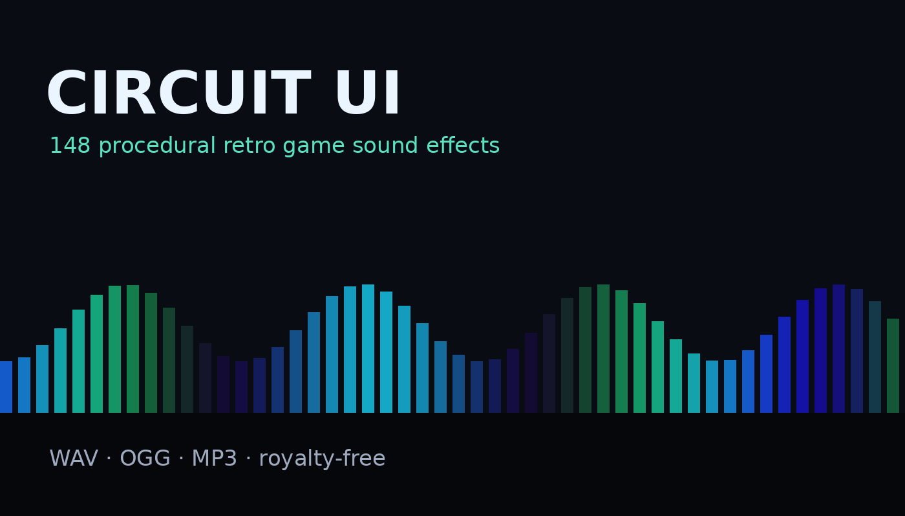

# Circuit UI SFX Vol. 1

Free sample and product information for **Circuit UI SFX Vol. 1**, a pack of 148 procedural retro/arcade game sound effects for game jams, prototypes, pixel-art games, and 8-bit/chiptune-style projects.

## Free sample

This repository includes 12 sample WAV files in `sample-wav/` and the packaged sample zip: `CircuitUI-SFX-free-sample.zip`.

You can also download it from the product page:

https://secondwindmc.github.io/assets/CircuitUI-SFX-free-sample.zip

## Full pack

The full pack includes:

- 148 WAV files, 44.1 kHz / 16-bit
- matching OGG and MP3 versions
- metadata CSV
- preview montage
- royalty-free commercial-use license

Product page and audio preview:

https://secondwindmc.github.io/circuit-ui-sfx.html

Technical write-up:

https://dev.to/secondwindmc/i-generated-148-retro-game-sound-effects-procedurally-in-python-dpa

Free browser sound-effect generator:

https://secondwindmc.github.io/retro-sfx-lab.html

## Distribution mirrors

- [OpenGameArt listing](https://opengameart.org/content/circuit-ui-sfx-free-sample)
- [Godot Asset Store page](https://store.godotengine.org/asset/secondwindmc/circuit-ui-sfx-free-sample/) (pending review)
- [Godot guide and direct zip](https://secondwindmc.github.io/godot-sound-effects.html)
- [GDevelop guide and direct zip](https://secondwindmc.github.io/gdevelop-sound-effects.html)

## Individual CC0 downloads

The sample sounds are also mirrored individually on vibeassets (all CC0):

- [Retro UI click sound effect](https://vibeassets.io/a/9y84jtvaaq)
- [Coin](https://vibeassets.io/a/sz7rnlzwyo)
- [Pickup](https://vibeassets.io/a/p9n6q7noev)
- [Powerup](https://vibeassets.io/a/f4a98dinqf)
- [Jump](https://vibeassets.io/a/cncqkfsbkk)
- [Hit](https://vibeassets.io/a/w78sie3avm)
- [Laser](https://vibeassets.io/a/lykd0fjx79)
- [Explosion](https://vibeassets.io/a/dgsyyxyd1v)
- [Success](https://vibeassets.io/a/fwlsieha3l)
- [Ui Confirm](https://vibeassets.io/a/m86tu4ky3j)

## License for the free sample

The 12 files in `sample-wav/` and the packaged free sample zip are released under CC0 1.0 Universal. See `SAMPLE-LICENSE.txt`.

The full paid pack uses the commercial redistribution-restricted license included in its zip file.
